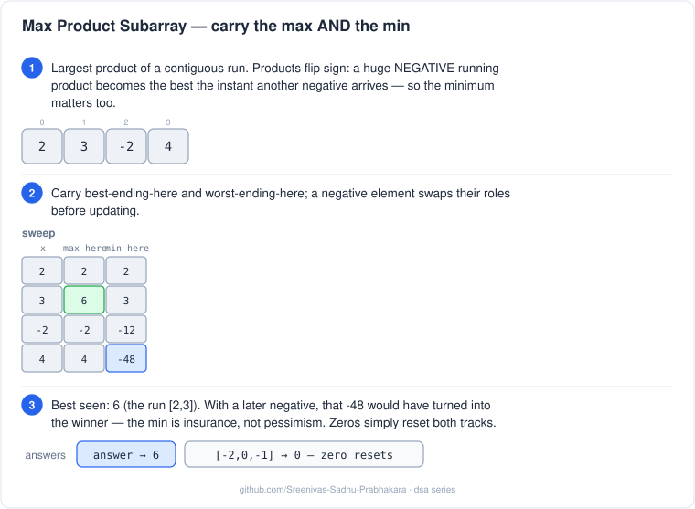

# Maximum Product Subarray

> Striver SDE Sheet 170 · Day 25 DP — Kadane with a shadow: carry the minimum product too, because one negative flips it into the new maximum. Go, stdlib only, tested.

## Problem

The largest product over all contiguous subarrays. Kadane's sum logic breaks on products: a hugely *negative* running product is one negative factor away from being hugely positive, so it can't be discarded.

## Approach

Track two running values ending at each position: the maximum product and the **minimum** product. Each new element has three candidate extensions — start fresh, extend the max, extend the min — and the new max/min are chosen from those three. The min is the insurance policy that pays off at the next negative number (`[-2, 3, -4]`: the −6 minimum becomes 24). Zeros need no special case — all candidates collapse through 0 and restart naturally. This "carry both extremes" trick generalizes to any DP where the combining operation isn't monotone.

**Complexity:** O(n) time, O(1) space.

## Visual walkthrough

Read the picture top to bottom — each numbered frame is one moment of the algorithm
running on this repo's test example.

## Run

    go test ./...   # verify
    go run .        # demo

---

One of 191 repos solving Striver's SDE Sheet in Go — stdlib only, one problem per repo, every solution tested. Browse the set: [`dsa-*` repos](https://github.com/Sreenivas-Sadhu-Prabhakara?tab=repositories&q=dsa-&type=source).
